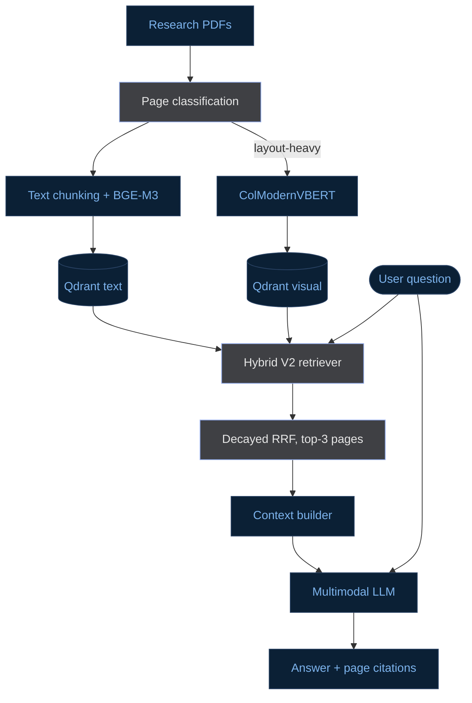

# Hybrid Multimodal RAG for Complex Document QA

*Balancing retrieval accuracy, vector storage efficiency, and ingestion cost for complex technical documents.*

## Overview

Traditional text-based RAG systems struggle to retrieve information from complex document layouts containing tables, figures, and equations. While visual retrieval can better preserve this information, indexing every page using multivector embeddings introduces substantial vector storage and ingestion overhead.

This project explores the **trade-off between retrieval effectiveness and indexing efficiency** through a multimodal RAG pipeline built with BGE-M3, ColModernVBERT, Qdrant, and LangGraph. It evaluates five retrieval strategies and develops **Hybrid V2**, which indexes text across all pages while selectively indexing layout-heavy pages visually, combining both retrieval channels using decayed Reciprocal Rank Fusion.

Evaluated on 78 curated questions across 95 research papers, Hybrid V2 achieved **87.8% Recall@3**, with estimated reductions of **36.1% in raw vector storage** and **25.8% in embedding/classification processing time** compared with full visual indexing. The **end-to-end RAG pipeline** using Gemini 3.8 Flash achieved **80.8% answer correctness**, with page-level citations and separate faithfulness evaluation.

## Highlights

- **Efficient Hybrid Ingestion:** Selective visual indexing reduces vector storage and ingestion overhead.
- **Five Retrieval Strategies:** Systematic ablations comparing text, visual, routed, and fused retrieval approaches.
- **End-to-End Multimodal RAG:** LangGraph-orchestrated retrieval and multimodal answer generation with page-level citations and standalone query support.

## System Architecture



The system consists of three main stages:

Document Ingestion: PDFs are classified by page layout and processed into text and visual embeddings. Hybrid V2 retains text embeddings for all pages and requires visual embeddings only for layout-heavy pages.

Hybrid Retrieval: BGE-M3 retrieves relevant text while ColModernVBERT searches layout-heavy pages. Decayed Reciprocal Rank Fusion combines both rankings and selects the top relevant pages.

Answer Generation: A LangGraph pipeline assembles retrieved page text and images, passes them to a multimodal LLM, and returns an evidence-grounded answer with page-level citations.

## Retrieval Strategies

Five retrieval configurations were implemented and evaluated to investigate retrieval accuracy, document layout understanding, and computational efficiency.

| Strategy | Text Retrieval | Visual Retrieval | Approach |
|---|---|---|---|
| **Text-only** | All pages | — | BGE-M3 semantic retrieval |
| **Visual-only** | — | All pages | ColModernVBERT multivector retrieval |
| **Hybrid Routed (V1)** | Text-dense pages | Layout-heavy pages | Strict page-type partitioning with RRF |
| **Unrouted Fusion** | All pages | All pages | Full multimodal retrieval with RRF |
| **Hybrid V2** | All pages | Layout-heavy pages | Selective visual retrieval with decayed RRF |

### Why Hybrid V2?

Initial experiments showed that strict page-type routing (**Hybrid Routed (V1): 71.2% Recall@3**) limited retrieval effectiveness, while **Unrouted Fusion (87.2% Recall@3)** improved accuracy at the cost of indexing every page visually.

**Hybrid V2 addresses this trade-off** by retaining text retrieval across the entire corpus and restricting visual indexing to layout-heavy pages. Decayed Reciprocal Rank Fusion combines the complementary retrieval signals, achieving **87.8% Recall@3** while reducing reliance on expensive visual embeddings.

This design preserves strong multimodal retrieval performance while offering estimated reductions of **36.1% in raw vector storage** and **25.8% in embedding/classification processing time** compared with full visual indexing.

Detailed comparisons are presented in the evaluations/results_retrieval section.

## Experimental Results

Evaluated on **78 curated questions across 95 research papers**, covering text, tables, figures, equations, and multi-step reasoning.

### 1. Retrieval Performance

| Strategy | Recall@3 | NDCG@3 | MRR |
|---|---:|---:|---:|
| Text-only | 83.3% | 75.6% | 75.4% |
| Visual-only | 84.0% | 72.7% | 71.3% |
| Hybrid Routed (V1) | 71.2% | 53.5% | 52.5% |
| Unrouted Fusion | 87.2% | **79.4%** | **79.1%** |
| **Hybrid V2** | **87.8%** | 79.1% | 77.9% |

**Key finding:** Hybrid V2 achieved the highest Recall@3, while Unrouted Fusion slightly outperformed it on ranking quality (NDCG@3 and MRR).

### 2. Indexing Efficiency

Estimated indexing requirements compared with full visual indexing:

| Metric | Full Visual | Hybrid V2 |
|---|---:|---:|
| Raw vector storage | 707.22 MiB | 451.72 MiB |
| Embedding + classification time | 117.66 min | 87.36 min |
| **Reduction** | — | **36.1% storage / 25.8% time** |

Hybrid V2 avoids visual embeddings for 42.3% of pages, while retaining text representations across the entire corpus.

*Note: Efficiency figures are modeled from recorded embedding and classification timings, not independently measured end-to-end deployment savings.*

### 3. End-to-End Generation Quality

Using Gemini 3.8 Flash with Hybrid V2 retrieval:

| Metric | Result |
|---|---:|
| Answer correctness | **80.8% (63/78)** |
| Correctness with complete gold-page retrieval | 92.5% (62/67) |
| Complete gold-page retrieval | 85.9% (67/78) |
| Manually adjudicated faithfulness | **97.4% (76/78)** |

The results highlight the importance of retrieving complete supporting evidence before answer generation. Faithfulness measures whether claims are supported by retrieved evidence and is distinct from answer correctness.

**Detailed Reports:**
- [Retrieval Ablation Analysis](evaluation/results_retrieval/v3_dataset/v3_deep_analysis_report.md)
- [Retrieval Metrics](evaluation/results_retrieval/v3_dataset/v3_ablation_metrics_summary.csv)
- [Generation Evaluation](evaluation/generation_quality/eval_results/report_tables.md)
- [Ingestion Efficiency](ingestion/reports/ingestion_efficiency_report%20%281%29.md)

## Setup & Usage

**Prerequisites:** Python, Qdrant, required embedding models, and API credentials for multimodal generation and evaluation.

```bash
pip install -r requirements.txt
```

Configure the required environment variables, including `QDRANT_URL`, `PDF_ROOT`, and the relevant API keys. Ensure Qdrant is running and the document collections are populated.

### Run the RAG Pipeline

```bash
# Single query (defaults to Hybrid V2 Decay@3)
python main.py --query "How does FlashAttention reduce memory usage?"

# Generate retrieval benchmark results
python main.py --eval retrieval

# Generate answer predictions
python main.py --eval generation --experiment retrieved
```

### Evaluate Saved Results

**Retrieval evaluation:**

```bash
python evaluation/retrieval_tests/v3_analysis.py \
  --file evaluation/results_retrieval/v3_dataset/benchmark_results.json \
  --out_dir evaluation/results_retrieval/v3_dataset
```

**Generation evaluation (offline metrics):**

```bash
python evaluation/generation_quality/evaluate.py offline \
  --predictions evaluation/results_generation/v3_dataset/gemini-3.8-flash/retrieved/predictions.jsonl \
  --golden evaluation/golden_dataset_v3.json
```

The generation evaluation additionally uses correctness and faithfulness judges. See the [Generation Evaluation Guide](evaluation/generation_quality/README.md) for the complete judging and reporting workflow.

## Repository Structure

```text
├── ingestion/          # PDF processing and indexing
├── evaluation/         # Golden datasets, evaluation scripts, and results
├── config.py           # System configuration
├── retriever.py        # Retrieval strategies
├── context_builder.py  # Retrieved evidence preparation
├── generator.py        # Multimodal answer generation
├── graph.py            # LangGraph workflow
├── main.py             # Main CLI entry point
├── run_ingestion.py    # Ingestion CLI
└── requirements.txt    # Python dependencies
```
